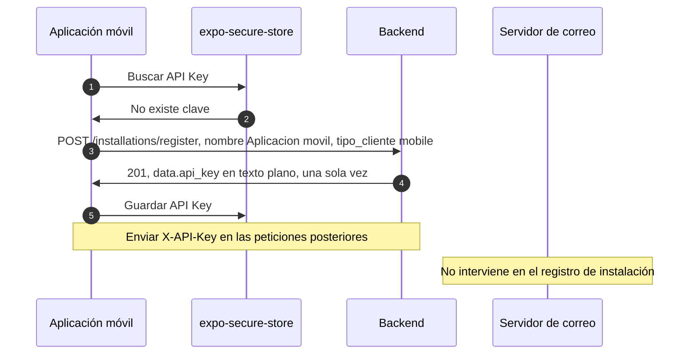
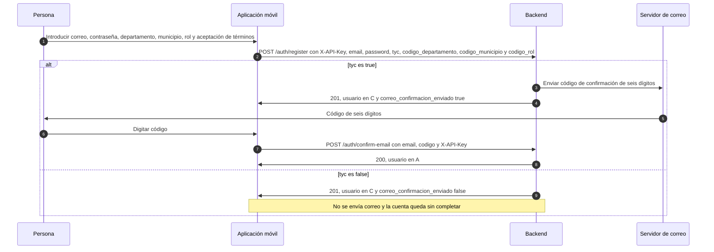
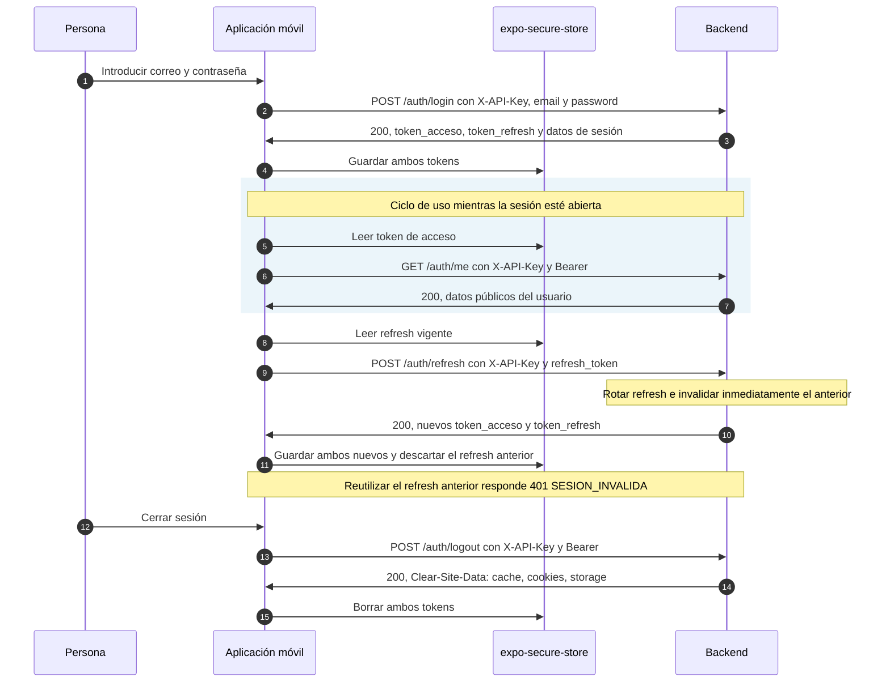
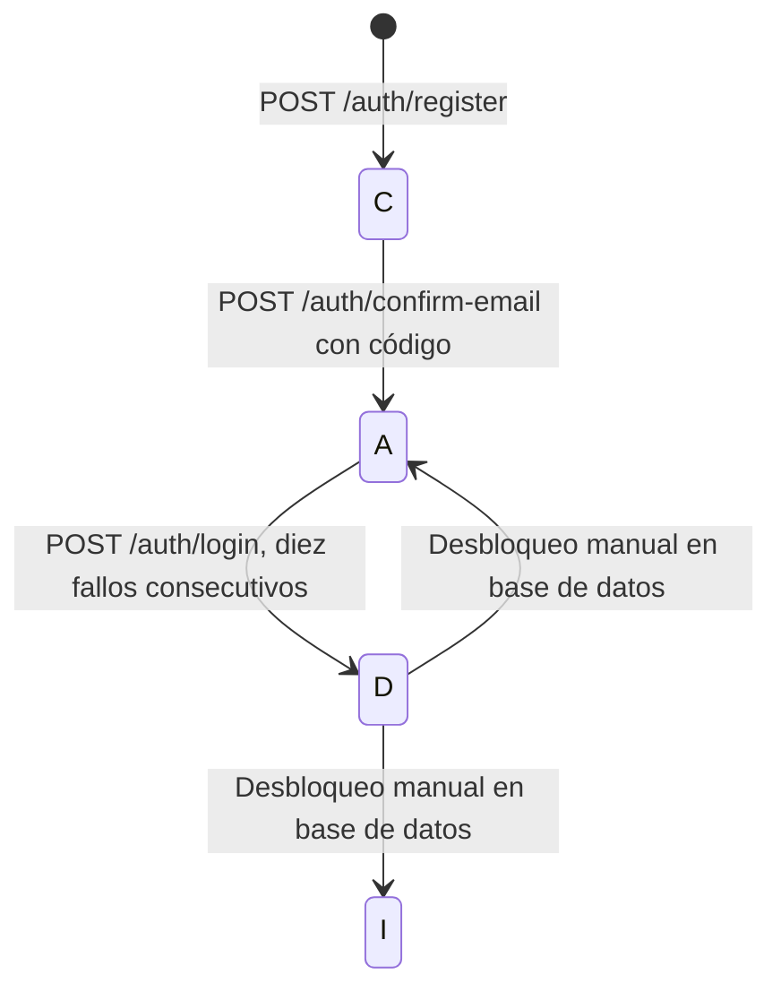

# Consumo del microservicio de login desde la aplicación móvil

Esta guía permite al equipo de React Native + Expo integrar el registro y las sesiones, y al equipo de backend verificar el contrato. Las rutas de negocio usan `/backend/{ambiente}/v{version}/`; los ejemplos usan `/backend/dev/v1`. Los diagnósticos `GET /` y `GET /health` no llevan prefijo. Consulte también `docs/api-guide.html` y `/api-docs.json`.

Las peticiones con cuerpo usan JSON. Todas las respuestas tienen la forma `{"message":"texto","error":null,"code":0,"data":{}}` en éxito; en error, `code` es el estado HTTP, `error` contiene `codigo` y `detalles` (arreglo de cadenas), y `data` puede ser `null`.

## Dos identidades

| Característica | API Key                                                       | Token de acceso                                                                           |
| -------------- | ------------------------------------------------------------- | ----------------------------------------------------------------------------------------- |
| Identifica     | La instalación de la aplicación, no a la persona.             | La persona autenticada.                                                                   |
| Almacenamiento | `expo-secure-store`; el servidor guarda solo el hash SHA-256. | `expo-secure-store`.                                                                      |
| Envío          | `X-API-Key` en las rutas de negocio protegidas.               | `Authorization: Bearer <token>` en rutas que lo exigen.                                   |
| Invalidación   | Cuando el backend la revoca o rechaza como inválida.          | Al vencer, por defecto a los 15 minutos; el cliente también lo descarta al cerrar sesión. |

## 1. Primer arranque

Si la clave es inválida o revocada, elimínela del almacén seguro y registre nuevamente la instalación. Un error de permiso requiere revisar el alcance, no repetir registros indiscriminadamente.

## 2. Registro y confirmación de correo

La contraseña tiene entre 8 y 72 caracteres, al menos una letra ASCII y un dígito, y no admite espacios en blanco. La cuenta siempre se crea en `C`. El departamento, el municipio y el rol son obligatorios: la app los toma de `GET /catalog/get-departments`, `get-municipalities?department=NN` y `get-roles`, y el municipio debe pertenecer al departamento elegido. Un código que no existe responde `400 CATALOGO_INVALIDO`.

La persona digita el código en la aplicación; la aplicación, no el navegador, llama al endpoint con su API Key y el permiso `auth:confirm-email`. El código se envía en el cuerpo JSON `{"email":"usuario@ejemplo.com","codigo":"123456"}`, nunca en la URL. La respuesta es 200 con `Correo confirmado.` y la cuenta queda en `A`. Tiene vigencia de 24 horas por defecto (`CONFIRM_CODE_TTL_HOURS`); el quinto fallo lo invalida y responde 429 (`CONFIRM_CODE_MAX_ATTEMPTS`, por defecto 5). Se persiste hasheado con argon2id en `dbo.codigo_confirmacion`, nunca en texto plano. El registro dispara el envío: quien integra el flujo llama a `generar` del servicio de códigos, que lo genera y persiste, y entrega después el código al servicio de correo.

## 3. Inicio, uso, renovación y cierre de sesión

El login devuelve `data.token_acceso`, `data.token_refresh`, `data.token_type` (`Bearer`), `data.expires_in` (900 segundos por defecto), `data.refresh_expires_at` y `data.usuario`. El acceso es JWT; el refresh es opaco y dura 30 días por defecto. Las duraciones son configurables. `GET /auth/me` devuelve UUID, correo, estado, `tyc` y fechas, nunca el hash de contraseña. El cierre revoca la sesión para renovaciones: el JWT se verifica por firma y vigencia, por lo que debe descartarse en el cliente. La cabecera exacta exclusiva del cierre es `Clear-Site-Data: "cache","cookies","storage"`.

## Estados de la cuenta

`C`: por confirmar; `A`: activa; `I`: inactiva; `D`: desactivada. No hay endpoint de desbloqueo: un operador autorizado utiliza `db/scripts/unlock-user.sql`, que deja la cuenta en `I` o `A` y borra los intentos fallidos. No se define aquí una transición de API hacia `I`. Las cuentas `C`, `I` y `D` no pueden iniciar sesión.

## Referencia de endpoints

Las rutas siguientes son relativas a `/backend/dev/v1`. Todas exigen `X-API-Key` salvo el registro de instalación; solo `logout` y `me` exigen además Bearer. La confirmación por enlace ya no existe.

| Método | Ruta                          | Alcance              | Cuándo se invoca                          | Cuerpo o consulta                                                                   | Respuesta resumida                                                    |
| ------ | ----------------------------- | -------------------- | ----------------------------------------- | ----------------------------------------------------------------------------------- | --------------------------------------------------------------------- |
| POST   | `/installations/register`     | Público              | Primer arranque o clave inválida/revocada | `nombre`, `tipo_cliente`                                                            | 201, `data.api_key` una sola vez.                                     |
| POST   | `/auth/register`              | `auth:register`      | Crear cuenta                              | `email`, `password`, `tyc`, `codigo_departamento`, `codigo_municipio`, `codigo_rol` | 201, `usuario` y `correo_confirmacion_enviado`.                       |
| POST   | `/auth/login`                 | `auth:login`         | Iniciar sesión                            | `email`, `password`                                                                 | 200, tokens y usuario.                                                |
| POST   | `/auth/confirm-email`         | `auth:confirm-email` | Confirmar correo desde la app             | `email`, `codigo`                                                                   | 200, usuario activo.                                                  |
| POST   | `/auth/refresh`               | `auth:refresh`       | Renovar sesión                            | `refresh_token`                                                                     | 200, tokens nuevos y usuario.                                         |
| POST   | `/auth/logout`                | `auth:logout`        | Cerrar sesión                             | Ninguno; Bearer                                                                     | 200, sesión revocada.                                                 |
| GET    | `/auth/me`                    | `auth:me`            | Consultar perfil                          | Ninguno; Bearer                                                                     | 200, `data.usuario` público.                                          |
| GET    | `/catalog/get-roles`          | `catalog:read`       | Llenar el selector de rol en el registro  | Ninguno; sin Bearer                                                                 | 200, `data.roles` con `codigo`, `nombre`, `area_servicio`.            |
| GET    | `/catalog/get-departments`    | `catalog:read`       | Llenar el selector de departamento        | Ninguno; sin Bearer                                                                 | 200, `data.departamentos` con `codigo` y `nombre`.                    |
| GET    | `/catalog/get-municipalities` | `catalog:read`       | Llenar el selector de municipio           | Consulta opcional `department` (2 dígitos); sin Bearer                              | 200, `data.municipios` con `codigo`, `nombre`, `codigo_departamento`. |

Además, `GET /` y `GET /health` son diagnósticos públicos sin prefijo; no forman parte del flujo de negocio. El catálogo de negocio tiene 11 operaciones.

Los catálogos no llevan Bearer porque se consultan durante el registro, cuando la persona aún no tiene sesión; sí exigen la API Key con el alcance `catalog:read`. Los códigos de departamento (`"05"`) y de municipio (`"05001"`) son texto y conservan los ceros a la izquierda; el código del rol es numérico.

## Límites y bloqueos

Los umbrales y la ventana son configurables; estos son los valores predeterminados.

| Control                  | Límite o acción                                                                                                                                |
| ------------------------ | ---------------------------------------------------------------------------------------------------------------------------------------------- |
| Inicio por identificador | 10 intentos fallidos para el mismo correo en 15 minutos activan `429 RATE_LIMIT_EXCEDIDO`.                                                     |
| Inicio por IP            | 50 intentos por IP en 15 minutos.                                                                                                              |
| Registro por IP          | 20 registros por IP en 15 minutos.                                                                                                             |
| Confirmación por correo  | 10 intentos (`RATE_LIMIT_CONFIRM_PER_IDENTIFIER`) en 15 minutos por defecto (`RATE_LIMIT_WINDOW_MINUTES`).                                                              |
| Confirmación por IP      | 30 intentos (`RATE_LIMIT_CONFIRM_PER_IP`) en 15 minutos por defecto (`RATE_LIMIT_WINDOW_MINUTES`).                                                                      |
| Código de confirmación   | Vigencia de 24 horas; el quinto fallo invalida el código y responde 429.                                                                       |
| Desactivación            | 10 fallos consecutivos dejan la cuenta en `D`; después el login responde `403 CUENTA_DESACTIVADA`. Es un control distinto del límite temporal. |
| Recuperación de `D`      | Manual en base de datos con `db/scripts/unlock-user.sql`; no existe endpoint administrativo.                                                   |

## Errores y acciones

Inspeccione el estado HTTP y `error.codigo`; no deduzca la causa solo del estado.

| Código                           | HTTP      | Acción de la app                                                                       |
| -------------------------------- | --------- | -------------------------------------------------------------------------------------- |
| `VALIDACION_FALLIDA`             | 400       | Mostrar los detalles y corregir la entrada.                                            |
| `USUARIO_YA_EXISTE`              | 409       | Informar que el correo ya está registrado.                                             |
| `CREDENCIALES_INVALIDAS`         | 401       | Solicitar corrección sin reintentos automáticos.                                       |
| `TOKEN_INVALIDO`                 | 400 o 401 | En Bearer, comprobar expiración y renovar si procede. |
| `TOKEN_REQUERIDO`                | 401       | Adjuntar el acceso si existe; de lo contrario, solicitar inicio de sesión.             |
| `SESION_INVALIDA`                | 401       | Descartar los tokens y solicitar inicio de sesión.                                     |
| `CUENTA_POR_CONFIRMAR`           | 403       | Indicar que debe confirmar el correo.                                                  |
| `CUENTA_INACTIVA`                | 403       | Indicar que la cuenta está inactiva y solicitar soporte.                               |
| `CUENTA_DESACTIVADA`             | 403       | Solicitar soporte para desbloqueo manual.                                              |
| `CUENTA_NO_ACTIVA`               | 403       | En renovación, informar que la cuenta no está activa y solicitar soporte.              |
| `CUENTA_YA_CONFIRMADA`           | 409       | Informar que la cuenta ya no está pendiente de confirmación.                           |
| `CODIGO_CONFIRMACION_NO_EXISTE`  | 404       | Informar que no existe código.                                                         |
| `CODIGO_CONFIRMACION_VENCIDO`    | 400       | Informar que el código venció.                                                         |
| `CODIGO_CONFIRMACION_INVALIDO`   | 400       | Solicitar corrección del código.                                                       |
| `CODIGO_CONFIRMACION_INVALIDADO` | 429       | Informar que el código fue invalidado.                                                 |
| `USUARIO_NO_ENCONTRADO`          | 404       | Informar y solicitar soporte según el flujo.                                           |
| `API_KEY_REQUERIDA`              | 401       | Comprobar y enviar la clave guardada; registrar instalación si falta.                  |
| `API_KEY_INVALIDA`               | 401       | Borrar la clave y registrar la instalación de nuevo.                                   |
| `API_KEY_REVOCADA`               | 401       | Borrar la clave y registrar la instalación de nuevo.                                   |
| `API_KEY_SIN_PERMISO`            | 403       | Revisar tipo de cliente y alcance con backend.                                         |
| `RATE_LIMIT_EXCEDIDO`            | 429       | Detener reintentos y solicitar que espere antes de volver a intentar.                  |
| `CATALOGO_INVALIDO`              | 400       | Volver a elegir departamento, municipio y rol desde los catálogos.                     |
| `ERROR_INTERNO`                  | 500       | Informar del fallo y permitir reintentar más tarde.                                    |

## Reglas para la app móvil

- Guarde API Key, acceso y refresh únicamente en `expo-secure-store` (Keystore en Android y Keychain en iOS), nunca en `AsyncStorage` ni en el estado de la interfaz. No registre credenciales en logs.
- No coloque credenciales en `EXPO_PUBLIC_*`: Expo las incluye en el binario distribuido y pueden leerse. La identidad de cliente se resuelve mediante la API Key por instalación.
- Use HTTPS con TLS 1.2 o superior. Envíe la clave de instalación en cada ruta protegida y Bearer solo donde se exige.
- Renueve preventivamente antes de que venza el acceso, según `expires_in`; el margen concreto no está definido. Evite renovaciones simultáneas para no competir por el mismo refresh rotativo. Guarde el nuevo refresh y descarte el anterior inmediatamente.
- Un `401 TOKEN_INVALIDO` en una ruta con Bearer puede indicar acceso vencido, pero no garantiza esa causa. Compruebe la vigencia y renueve si corresponde; no interprete un fallo de API Key como fallo de usuario. Un `401 SESION_INVALIDA` de `/auth/refresh` indica refresh inválido, revocado o vencido: descarte ambos tokens y solicite inicio de sesión.
- La API Key identifica a la instalación; el acceso identifica a la persona. No sustituya uno por otro. El token de reseteo no es un token de acceso.

## Pendientes de integración

- CAPTCHA en inicio de sesión, lineamiento 3.8: aún no implementado.
- Segundo factor de autenticación, lineamiento 3.8: pendiente; no hay flujo definido en este servicio.
- OAuth 2.0 con PKCE y apertura del navegador del sistema, lineamiento 1.6.3: pendiente; el flujo actual es login propio con refresh.
- Desbloqueo administrativo de cuentas `D`: pendiente como endpoint; actualmente requiere operación manual en base de datos.
