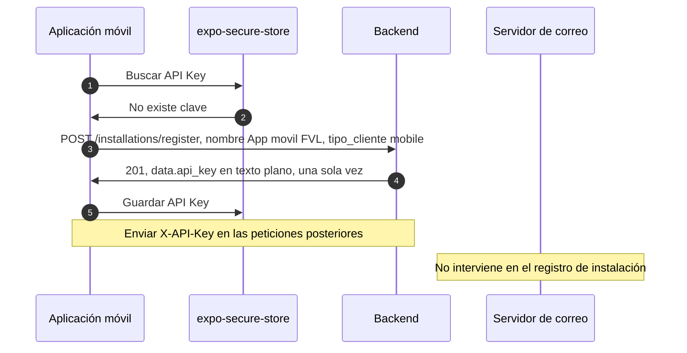
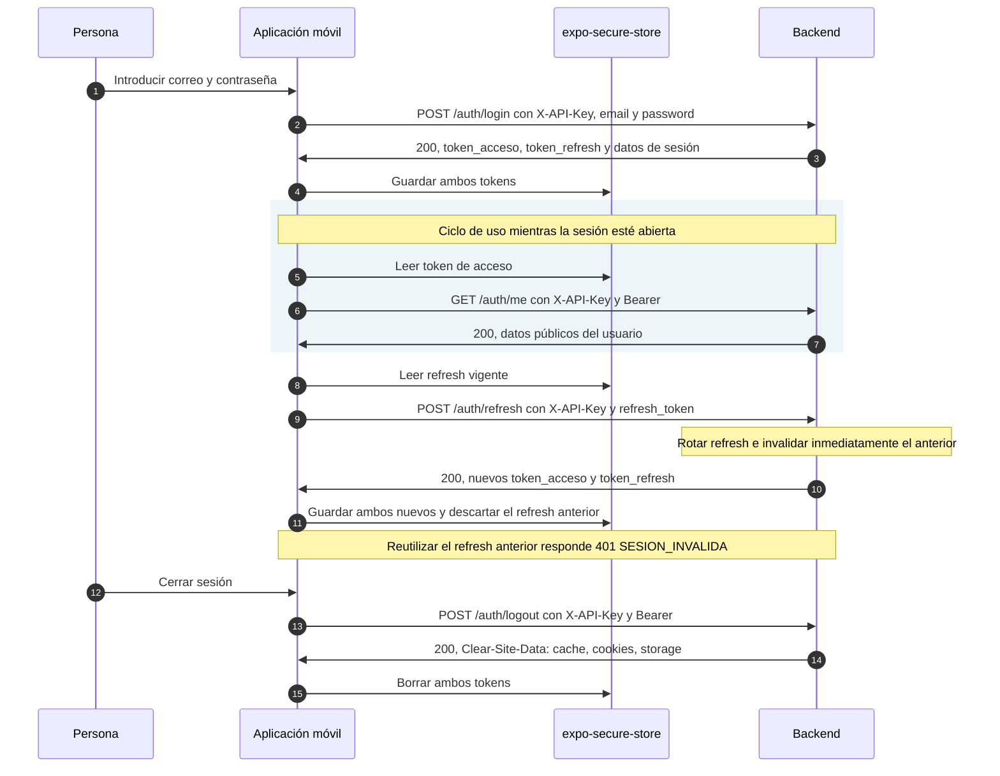
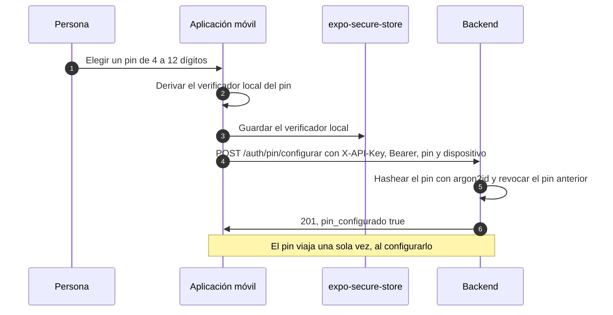
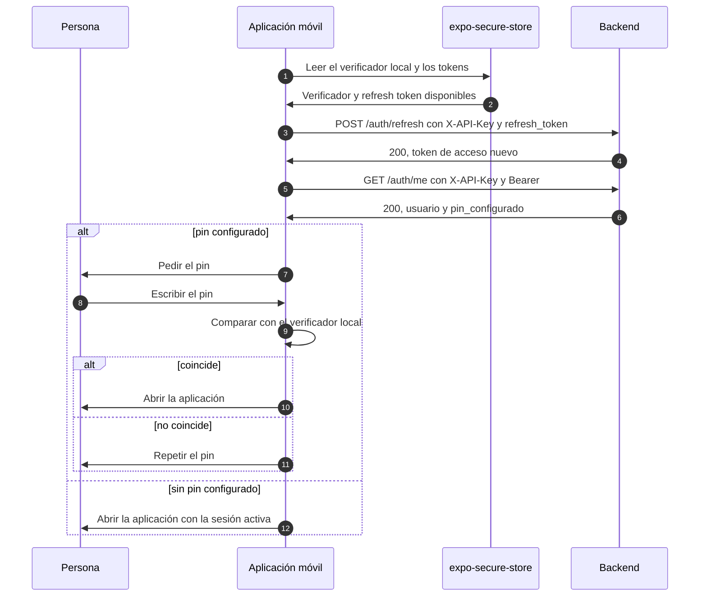
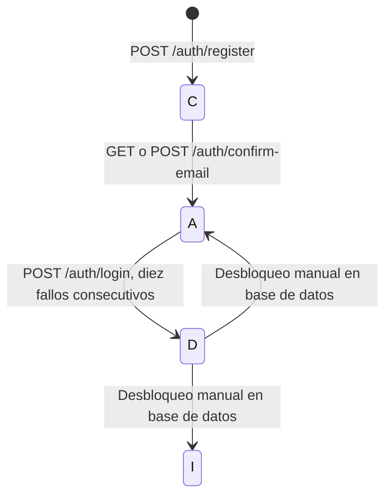

# Consumo del microservicio de login desde la aplicación móvil

Esta guía permite al equipo de React Native + Expo integrar el registro y las sesiones, y al equipo de backend verificar el contrato. Las rutas de negocio usan `/backend/{ambiente}/v{version}/`; los ejemplos usan `/backend/dev/v1`. Los diagnósticos `GET /` y `GET /health` no llevan prefijo. Consulte también `docs/api-guide.html` y `/api-docs.json`.

Las peticiones con cuerpo usan JSON. Todas las respuestas tienen la forma `{"message":"texto","error":null,"code":0,"data":{}}` en éxito; en error, `code` es el estado HTTP, `error` contiene `codigo` y `detalles` (arreglo de cadenas), y `data` puede ser `null`.

## Dos identidades

| Característica | API Key                                                       | Token de acceso                                                                           |
| -------------- | ------------------------------------------------------------- | ----------------------------------------------------------------------------------------- |
| Identifica     | La instalación de la aplicación, no a la persona.             | La persona autenticada.                                                                   |
| Almacenamiento | `expo-secure-store`; el servidor guarda solo el hash SHA-256. | `expo-secure-store`.                                                                      |
| Envío          | `X-API-Key` en las rutas de negocio protegidas.               | `Authorization: Bearer <token>` en rutas que lo exigen.                                   |
| Invalidación   | Cuando el backend la revoca o rechaza como inválida.          | Al vencer, por defecto a los 15 minutos; el cliente también lo descarta al cerrar sesión. |

## 1. Primer arranque



Si la clave es inválida o revocada, elimínela del almacén seguro y registre nuevamente la instalación. Un error de permiso requiere revisar el alcance, no repetir registros indiscriminadamente.

## 2. Registro y confirmación de correo

La contraseña tiene entre 8 y 72 caracteres, al menos una letra ASCII y un dígito, y no admite espacios en blanco. La cuenta siempre se crea en `C`.

```mermaid
sequenceDiagram
    autonumber
    participant Persona as Persona
    participant App as Aplicación móvil
    participant Backend as Backend
    participant Correo as Servidor de correo
    Persona->>App: Introducir correo, contraseña y aceptación de términos
    App->>Backend: POST /auth/register con X-API-Key, email, password y tyc
    alt tyc es true
        Backend->>Correo: Enviar enlace de confirmación
        Backend->>App: 201, usuario en C y correo_confirmacion_enviado true
        Correo->>Persona: Enlace con token JWT de 24 horas y un solo uso
        Persona->>App: Abrir enlace
        App->>Backend: GET /auth/confirm-email con token y X-API-Key
        Backend->>App: 200, usuario en A
    else tyc es false
        Backend->>App: 201, usuario en C y correo_confirmacion_enviado false
        Note over App,Backend: No se envía correo; la cuenta queda sin completar
    end
```

El enlace apunta a `GET /backend/dev/v1/auth/confirm-email?token=...`, pero esa ruta exige `X-API-Key`: un navegador que lo abra directamente no puede aportar la cabecera. Por eso el dominio del backend se declara como enlace de app y enlace universal: el correo abre la aplicacion y es la aplicacion, que ya conoce la API Key, quien llama al backend. El equipo movil entrega para eso dos archivos que el dominio debe servir en `/.well-known/`, con la estructura indicada en `nginx/well-known/README.md`. Mientras esa reserva no exista, el token puede enviarse con `POST /auth/confirm-email`. Un enlace vencido o usado responde `400 TOKEN_INVALIDO`; una cuenta ya confirmada puede responder `409 CUENTA_YA_CONFIRMADA`.

## 3. Inicio, uso, renovación y cierre de sesión



El login devuelve `data.token_acceso`, `data.token_refresh`, `data.token_type` (`Bearer`), `data.expires_in` (900 segundos por defecto), `data.refresh_expires_at` y `data.usuario`. El acceso es JWT; el refresh es opaco y dura 30 días por defecto. Las duraciones son configurables. `GET /auth/me` devuelve UUID, correo, estado, `tyc` y fechas, nunca el hash de contraseña. El cierre revoca la sesión para renovaciones: el JWT se verifica por firma y vigencia, por lo que debe descartarse en el cliente. La cabecera exacta exclusiva del cierre es `Clear-Site-Data: "cache","cookies","storage"`.

## 4. Recuperación y cambio de contraseña

```mermaid
sequenceDiagram
    autonumber
    participant Persona as Persona
    participant App as Aplicación móvil
    participant Backend as Backend
    participant Correo as Servidor de correo
    alt Recuperación sin sesión
        Persona->>App: Solicitar recuperación con su correo
        App->>Backend: POST /auth/forgot-password con X-API-Key y email
        Note over Backend,Correo: Si la cuenta existe y está en A o C, enviar enlace de 30 minutos
        Backend->>Correo: Envío condicional del enlace de un solo uso
        Backend->>App: 200 con mensaje genérico para cuenta existente o no
        Correo->>Persona: Enlace de recuperación cuando corresponda
        Persona->>App: Abrir enlace
        App->>Backend: GET /auth/reset-password con token y X-API-Key
        Backend->>App: 200 si es válido, sin cambiar contraseña
        Persona->>App: Introducir nueva contraseña
        App->>Backend: POST /auth/reset-password con token, nueva_password y X-API-Key
        Backend->>App: 200, contraseña actualizada
        Note over Backend: El enlace deja de servir y se revocan las sesiones
    else Cambio con sesión abierta
        Persona->>App: Introducir contraseña actual y nueva
        App->>Backend: POST /auth/change-password con X-API-Key, Bearer y ambas contraseñas
        Backend->>App: 200, contraseña actualizada
        Note over Backend: Se revocan las demás sesiones; la actual permanece abierta
    end
```

La respuesta genérica corresponde a solicitudes válidas; una entrada inválida puede devolver `400 VALIDACION_FALLIDA`. La validación del enlace con `GET` es opcional y exige la API Key, igual que la confirmación: se aplica el mismo mecanismo de enlace de app y universal. Una contraseña actual incorrecta devuelve `400 PASSWORD_ACTUAL_INVALIDA`.

## 5. Pin de acceso

El pin es un candado **local** del dispositivo: la persona lo configura una vez, despues de iniciar
sesion, y al reabrir la aplicacion la app pide solo el pin en lugar de las credenciales.

**El pin nunca viaja al servidor.** Un pin de cuatro a seis digitos tiene muy poca entropia, y
enviarlo en cada apertura lo exponeria a la red y a los intentos por fuerza bruta. Por eso:

- La app guarda en el almacen seguro del dispositivo el **verificador** del pin (argon2id sobre el
  pin, con sal aleatoria) y lo compara en el dispositivo cuando la persona lo escribe. Ese
  verificador nunca se transmite.
- El microservicio guarda **otro** verificador, tambien argon2id, y lo usa para tres cosas que no
  requieren conocer el pin: permitir reconfigurarlo, permitir revocarlo desde otro dispositivo, y
  usarlo como segunda confirmacion en operaciones sensibles.

### Configuracion

Para el usuario



### Apertura de la aplicacion



La comparacion del pin ocurre **en el dispositivo**, sin red y sin limite de intentos del servidor.
Si el pin no coincide, la app vuelve a pedirlo; el numero de intentos vive en el dispositivo.

### Confirmacion en operaciones sensibles

Cuando la app necesita una segunda confirmacion antes de una operacion que lo exige (cambiar la
contrasena, ver datos personales, revocar sesiones de otros dispositivos), envia el pin al
servidor con `POST /auth/pin/verificar`. Ahi si cuenta el servidor: tras cinco intentos
fallidos el pin queda **revocado** y la cuenta sigue activa, porque el bloqueo de la cuenta es
para el acceso con contrasena, no para el pin.

### Revocacion

`POST /auth/pin/revocar` revoca el pin de la cuenta. La app debe borrar el verificador local y
pedir el pin de nuevo en la siguiente apertura. Sirve para el caso de un equipo extraviado o de
sospecha de que alguien conoce el pin.

## Estados de la cuenta



`C`: por confirmar; `A`: activa; `I`: inactiva; `D`: desactivada. No hay endpoint de desbloqueo: un operador autorizado utiliza `db/scripts/unlock-user.sql`, que deja la cuenta en `I` o `A` y borra los intentos fallidos. No se define aquí una transición de API hacia `I`. Las cuentas `C`, `I` y `D` no pueden iniciar sesión.

## Referencia de endpoints

Las rutas siguientes son relativas a `/backend/dev/v1`. Todas exigen `X-API-Key` salvo el registro de instalación; solo `logout`, `change-password` y `me` exigen además Bearer. Los enlaces abiertos por navegador también necesitan la API Key mediante un cliente o intermediario autorizado.

| Método | Ruta                      | Alcance               | Cuándo se invoca                               | Cuerpo o consulta                           | Respuesta resumida                              |
| ------ | ------------------------- | --------------------- | ---------------------------------------------- | ------------------------------------------- | ----------------------------------------------- |
| POST   | `/installations/register` | Público               | Primer arranque o clave inválida/revocada      | `nombre`, `tipo_cliente`                    | 201, `data.api_key` una sola vez.               |
| POST   | `/auth/register`          | `auth:register`       | Crear cuenta                                   | `email`, `password`, `tyc`                  | 201, `usuario` y `correo_confirmacion_enviado`. |
| POST   | `/auth/login`             | `auth:login`          | Iniciar sesión                                 | `email`, `password`                         | 200, tokens y usuario.                          |
| POST   | `/auth/confirm-email`     | `auth:confirm-email`  | Confirmar correo desde la app                  | `token`                                     | 200, usuario activo.                            |
| GET    | `/auth/confirm-email`     | `auth:confirm-email`  | Abrir enlace de confirmación                   | Consulta `token`                            | 200, usuario activo.                            |
| POST   | `/auth/refresh`           | `auth:refresh`        | Renovar sesión                                 | `refresh_token`                             | 200, tokens nuevos y usuario.                   |
| POST   | `/auth/logout`            | `auth:logout`         | Cerrar sesión                                  | Ninguno; Bearer                             | 200, sesión revocada.                           |
| POST   | `/auth/forgot-password`   | `auth:password-reset` | Solicitar recuperación                         | `email`                                     | 200 genérico para solicitud válida.             |
| POST   | `/auth/reset-password`    | `auth:password-reset` | Definir nueva contraseña con enlace            | `token`, `nueva_password`                   | 200, contraseña actualizada.                    |
| GET    | `/auth/reset-password`    | `auth:password-reset` | Validar enlace antes del formulario            | Consulta `token`                            | 200, correo en `data`, sin cambiar contraseña.  |
| POST   | `/auth/change-password`   | `auth:password-reset` | Cambiar contraseña con sesión abierta          | `password_actual`, `nueva_password`; Bearer | 200, contraseña actualizada.                    |
| GET    | `/auth/me`                | `auth:me`             | Consultar perfil                               | Ninguno; Bearer                             | 200, `data.usuario` público.                    |
| POST   | `/auth/pin/configurar`    | `auth:pin`            | Configurar o cambiar el pin                    | `pin`, `dispositivo`                        | 201, `pin_configurado`.                         |
| POST   | `/auth/pin/verificar`     | `auth:pin`            | Segunda confirmacion en una operacion sensible | `pin`                                       | 200, `verificado`.                              |
| POST   | `/auth/pin/revocar`       | `auth:pin`            | Revocar el pin de la cuenta                    | Ninguno                                     | 200, `pin_revocado`.                            |

Además, `GET /` y `GET /health` son diagnósticos públicos sin prefijo; no forman parte del flujo de negocio. El catálogo de negocio tiene 12 operaciones.

## Límites y bloqueos

Los umbrales y la ventana son configurables; estos son los valores predeterminados.

| Control                  | Límite o acción                                                                                                                                |
| ------------------------ | ---------------------------------------------------------------------------------------------------------------------------------------------- |
| Inicio por identificador | 10 intentos fallidos para el mismo correo en 15 minutos activan `429 RATE_LIMIT_EXCEDIDO`.                                                     |
| Inicio por IP            | 50 intentos por IP en 15 minutos.                                                                                                              |
| Registro por IP          | 20 registros por IP en 15 minutos.                                                                                                             |
| Desactivación            | 10 fallos consecutivos dejan la cuenta en `D`; después el login responde `403 CUENTA_DESACTIVADA`. Es un control distinto del límite temporal. |
| Recuperación de `D`      | Manual en base de datos con `db/scripts/unlock-user.sql`; no existe endpoint administrativo.                                                   |

## Errores y acciones

Inspeccione el estado HTTP y `error.codigo`; no deduzca la causa solo del estado.

| Código                     | HTTP      | Acción de la app                                                                        |
| -------------------------- | --------- | --------------------------------------------------------------------------------------- |
| `VALIDACION_FALLIDA`       | 400       | Mostrar los detalles y corregir la entrada.                                             |
| `USUARIO_YA_EXISTE`        | 409       | Informar que el correo ya está registrado.                                              |
| `CREDENCIALES_INVALIDAS`   | 401       | Solicitar corrección sin reintentos automáticos.                                        |
| `PASSWORD_ACTUAL_INVALIDA` | 400       | Solicitar la contraseña actual correcta.                                                |
| `TOKEN_INVALIDO`           | 400 o 401 | En enlaces, solicitar uno nuevo; en Bearer, comprobar expiración y renovar si procede.  |
| `TOKEN_REQUERIDO`          | 401       | Adjuntar el acceso si existe; de lo contrario, solicitar inicio de sesión.              |
| `SESION_INVALIDA`          | 401       | Descartar los tokens y solicitar inicio de sesión.                                      |
| `CUENTA_POR_CONFIRMAR`     | 403       | Indicar que debe confirmar el correo.                                                   |
| `CUENTA_INACTIVA`          | 403       | Indicar que la cuenta está inactiva y solicitar soporte.                                |
| `CUENTA_DESACTIVADA`       | 403       | Solicitar soporte para desbloqueo manual.                                               |
| `CUENTA_NO_ACTIVA`         | 403       | En renovación, informar que la cuenta no está activa y solicitar soporte.               |
| `CUENTA_YA_CONFIRMADA`     | 409       | Informar que la cuenta ya no está pendiente de confirmación.                            |
| `USUARIO_NO_ENCONTRADO`    | 404       | Informar y solicitar soporte según el flujo.                                            |
| `API_KEY_REQUERIDA`        | 401       | Comprobar y enviar la clave guardada; registrar instalación si falta.                   |
| `API_KEY_INVALIDA`         | 401       | Borrar la clave y registrar la instalación de nuevo.                                    |
| `API_KEY_REVOCADA`         | 401       | Borrar la clave y registrar la instalación de nuevo.                                    |
| `API_KEY_SIN_PERMISO`      | 403       | Revisar tipo de cliente y alcance con backend.                                          |
| `RATE_LIMIT_EXCEDIDO`      | 429       | Detener reintentos y solicitar que espere antes de volver a intentar.                   |
| `ERROR_INTERNO`            | 500       | Informar del fallo y permitir reintentar más tarde.                                     |
| `PIN_INVALIDO`             | 401       | El pin de acceso no es correcto.                                                        |
| `PIN_REVOCADO`             | 403       | El pin se revoco por intentos fallidos; hay que volver a iniciar sesion y configurarlo. |
| `PIN_NO_CONFIGURADO`       | 404       | La cuenta no tiene ningun pin de acceso configurado.                                    |

## Reglas para la app móvil

- Guarde API Key, acceso y refresh únicamente en `expo-secure-store` (Keystore en Android y Keychain en iOS), nunca en `AsyncStorage` ni en el estado de la interfaz. No registre credenciales en logs.
- No coloque credenciales en `EXPO_PUBLIC_*`: Expo las incluye en el binario distribuido y pueden leerse. La identidad de cliente se resuelve mediante la API Key por instalación.
- Use HTTPS con TLS 1.2 o superior. Envíe la clave de instalación en cada ruta protegida y Bearer solo donde se exige.
- El pin se compara **en el dispositivo** contra el verificador local guardado en `expo-secure-store`. No lo envie al servidor para desbloquear la aplicacion: solo se envia cuando la app necesita una segunda confirmacion en una operacion sensible.
- Renueve preventivamente antes de que venza el acceso, según `expires_in`; el margen concreto no está definido. Evite renovaciones simultáneas para no competir por el mismo refresh rotativo. Guarde el nuevo refresh y descarte el anterior inmediatamente.
- Un `401 TOKEN_INVALIDO` en una ruta con Bearer puede indicar acceso vencido, pero no garantiza esa causa. Compruebe la vigencia y renueve si corresponde; no interprete un fallo de API Key como fallo de usuario. Un `401 SESION_INVALIDA` de `/auth/refresh` indica refresh inválido, revocado o vencido: descarte ambos tokens y solicite inicio de sesión.
- La API Key identifica a la instalación; el acceso identifica a la persona. No sustituya uno por otro. Los tokens de correo son de un solo uso y no son tokens de acceso.

## Pendientes de integración

- CAPTCHA en inicio de sesión, lineamiento 3.8: aún no implementado.
- Segundo factor de autenticación, lineamiento 3.8: pendiente; no hay flujo definido en este servicio.
- OAuth 2.0 con PKCE y apertura del navegador del sistema, lineamiento 1.6.3: pendiente; el flujo actual es login propio con refresh.
- Desbloqueo administrativo de cuentas `D`: pendiente como endpoint; actualmente requiere operación manual en base de datos.
- Publicación de los archivos de verificación de enlaces: el equipo de la aplicación móvil debe entregar `assetlinks.json` y `apple-app-site-association` con el contenido indicado en `nginx/well-known/README.md`, y operación debe publicarlos en el dominio del backend. Hasta entonces, el enlace de confirmación y el de reseteo abiertas en el navegador responden `401 API_KEY_REQUERIDA`.
